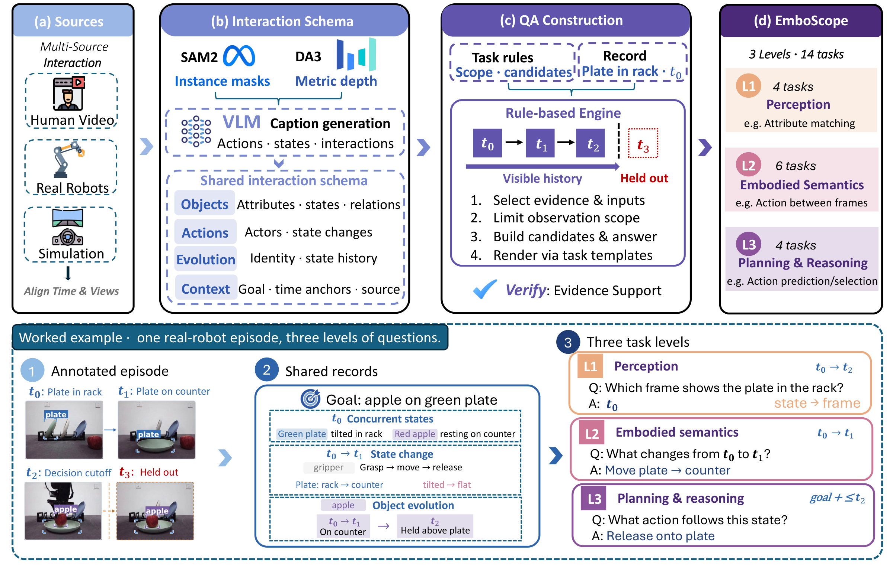
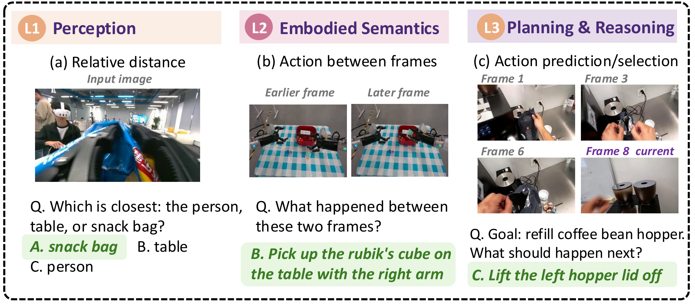
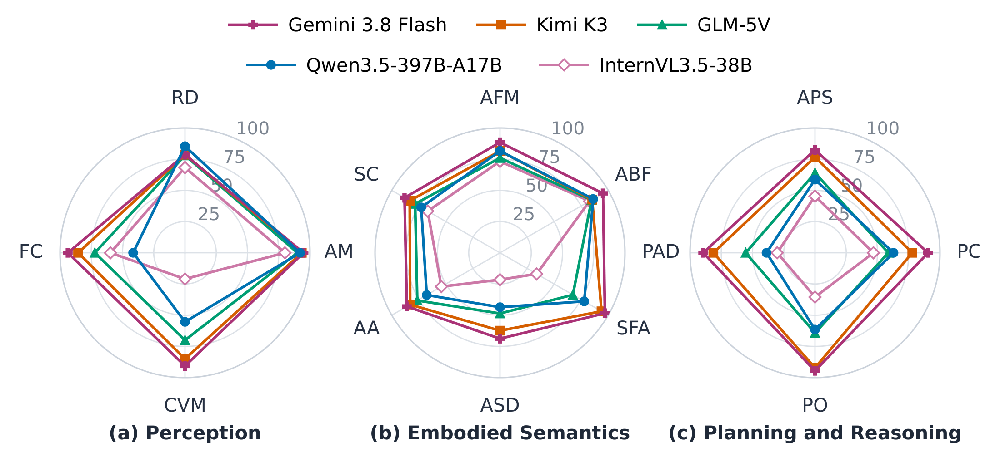
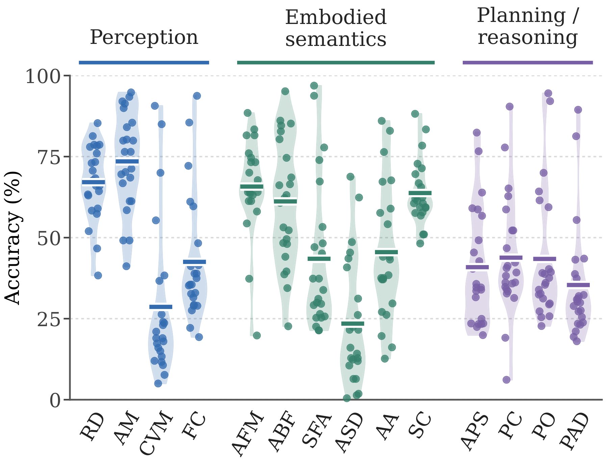

# EmboScope

[English](README.md)

本仓库为论文 **《EmboScope: A Multi-Source Comprehensive Benchmark for Embodied Perception, Understanding, and Planning》对应的评测代码与数据集**，包括评测输入准备、模型推理、封闭题评分，以及开放题裁判。

本版本包含全部 **4,467 道合成视觉问答题、14 类任务**及评测代码。三层题量为 1,241 / 1,752 / 1,474，任务数为 4 / 6 / 4。动作预测与选择（APS）归入 L3。

## Benchmark 概览

### 数据构建框架

[](docs/figures/overview.pdf)

论文中的构建框架将交互观察整理为包含对象、动作、状态和时间关系的共享表示，再按各任务的观察范围生成问题。下方示例展示同一段交互如何构造三层能力问题；动作预测时将未来观察保留为参考证据。[查看 PDF 原图](docs/figures/overview.pdf)。

### 代表性任务示例

[](docs/figures/task_examples.pdf)

三个示例分别展示相对近远判断、帧间动作识别和动作预测与选择。绿色标出参考答案。图中题干经过缩写，(b)、(c) 省略了干扰选项；(c) 展示第 1、3、6、8 个输入，其中第 8 帧是当前观察。[查看 PDF 原图](docs/figures/task_examples.pdf)。

### 论文报告的评测结果

[](docs/figures/capability_profiles.pdf)

**模型能力分布。** 五个代表性基线统一使用 0–100% 准确率刻度，每条轴对应一个任务；多边形面积不表示综合得分，也不用于跨面板比较。[查看 PDF 原图](docs/figures/capability_profiles.pdf)。

[](docs/figures/task_accuracy.pdf)

**各任务准确率分布。** 散点表示各模型的准确率，短横线表示均值，小提琴图表示被评模型的得分分布。[查看 PDF 原图](docs/figures/task_accuracy.pdf)。

<details>
<summary>图中任务缩写</summary>

| 层级 | 缩写 | 任务 |
| --- | --- | --- |
| L1 | RD | 相对近远判断 |
| L1 | AM | 属性与状态匹配 |
| L1 | CVM | 跨视角状态匹配 |
| L1 | FC | 连续交互缺帧补全 |
| L2 | AFM | 动作与帧匹配 |
| L2 | ABF | 帧间动作识别 |
| L2 | SFA | 步骤与图组对齐 |
| L2 | ASD | 动作序列描述 |
| L2 | AA | 相邻动作识别 |
| L2 | SC | 指定步骤完成判定 |
| L3 | APS | 动作预测与选择 |
| L3 | PC | 目标进度比较 |
| L3 | PO | 目标进度排序 |
| L3 | PAD | 目标进度异常检测 |

</details>

## 数据结构

- `evaluate.sh`：串联数据准备、模型推理、开放题裁判与评分的统一入口。
- `data/`：固定的数据下载位置，代码仓库中仅保留空目录占位。
- `data/benchmark_data.jsonl`：下载后放入的全部题目，固定 ID 为 `q000001` 至 `q004467`，没有 `source` 字段。
- `data/images/`：下载后放入的全部视觉输入，按内容哈希命名，共 42,637 张独立图片，约 4.65 GB。
- `metadata/`：图片校验清单、数据版本与统计、229 道视频题的固定帧位置。
- `eval/`：可安装的评测包、辅助脚本和测试。
- `configs/`：通用模型与裁判配置、24 组本地模型评测配置，以及 InternVL Thinking 专用提示词。
- `deploy/`：本地模型启动入口、依赖版本、HY 原生推理服务及 Phi/HY 兼容补丁。
- `docs/figures/`：README 使用的论文展示图，包含 PNG 预览和 PDF 原图，随代码仓库发布。

图片引用形如 `images/<sha256>.jpg`，相对于 JSONL 所在目录解析。229 道视频题使用固定图片序列，按题目指定顺序与图文绑定提供视觉输入。相同图片字节只存一份，题目中的重复引用仍然保留。

clone 仓库后，只需下载对应版本的 JSONL 和媒体，将它们放到 **`data/benchmark_data.jsonl` 和 `data/images/`**。评测入口固定读取此位置，无需填写数据路径。题目和媒体由 Git 忽略，也不打入代码包；校验清单已随代码放在根目录 `metadata/` 中，无需用户另行准备。

在仓库根目录，将完整数据包解压到 `data/`：

```bash
tar -xzf /下载位置/embodied-benchmark-data-v0.2.1.tar.gz -C data
```

解压后应直接得到 `data/benchmark_data.jsonl` 和 `data/images/`，不要再嵌套一层 `data/`。单独下载 JSONL 和图片时也保持此结构。README 展示图仍随代码发布。详见[打包说明](docs/RELEASING.md)。

## 论文中的本地模型

已加入论文中的 **20 个本地模型、24 组评测配置**，覆盖 4 组 Thinking 实验。主要模型使用 vLLM，HY-Embodied-0.5 使用独立 Transformers 服务。部署环境与评测环境分开安装，完整步骤见[本地部署说明](deploy/README.md)。

```bash
bash deploy/serve.sh --list
bash deploy/install.sh --environment vllm --venv .venvs/vllm --dry-run
```

启动服务后生成可直接传给 `evaluate.sh` 的 `model.json`；Qwen A17B 还会生成本地裁判使用的 `judge.json`。InternVL Thinking 评测需要加上 `--prompts-path configs/prompts/internvl35-14b-thinking.json`。权重和模型运行环境另行下载；启动时选择 `--profile`，通过 `--model-path` 指定权重目录即可，部署信息自动记录。

## 快速开始

使用 Linux/macOS、Python 3.10 或以上版本：

```bash
python -m venv .venv
source .venv/bin/activate
python -m pip install .
```

使用本仓库部署本地模型时，直接将生成的 `model.json` 和 `judge.json` 传给评测入口。接入已有服务时，填写 `configs/model.example.json` 和 `configs/judge.example.json` 中的服务地址、模型名称及生成参数，然后运行：

```bash
bash evaluate.sh \
  --model-config configs/model.example.json \
  --judge-config configs/judge.example.json \
  --output artifacts/my_model
```

脚本依次执行数据准备、模型推理、开放题裁判和评分。结果写入 `artifacts/my_model/scores/report.json` 和 `report.md`；中间结果分别保存在该目录下的 `corpus/`、`model/`、`judge/`、`scores/`、`logs/` 中。脚本调用当前仓库中的 Python 评测实现，密钥通过环境变量提供。

重复执行同一条命令即可续跑，已完成的响应会直接复用。脚本会核对数据、题目选择、提示词和评测代码；推理未完成时先保存阶段报告并停止，待推理完成后再启动裁判。推理或评分未完成时退出码为 3，应先检查日志，再按错误类型显式使用 `--retry-pending` 或 `--retry-unknown`。

常用选项：

| 选项 | 用途 |
| --- | --- |
| `--per-task 1` | 每类取 1 题检查完整流程；使用独立输出目录，续跑时保留此参数 |
| `--stage prepare/run/judge/score` | 选择一个阶段单独执行，参数取其中一个值 |
| `--skip-judge` | 只计算封闭题分数；开放题保持未评分，总准确率不视为完整结果 |
| `--prompts-path 路径` | 指定提示词包；InternVL Thinking 使用随仓库提供的专用文件 |
| `--python 路径` | 指定 Python 解释器 |

完整参数见 `bash evaluate.sh --help`。原有 `embodied-eval` 命令仍可单独使用，见[英文说明](README.md#individual-cli-commands)与[评分规则](docs/EVALUATION.md)。全量数据校验可以独立执行：

```bash
embodied-eval validate --output artifacts/data_validation.json
```

`text_list[-1]` 为参考答案；编译器只向被评模型发送之前的题干、选项和公开媒体。所有参考答案随本版公开，`private/answers.jsonl` 仅表示评测内部的输入与评分隔离。

已准备语料通过相对路径定位数据；搬迁时保留仓库、`data/` 和评测输出的相对布局。安装后的 `embodied-eval` 命令在仓库内执行；`evaluate.sh` 可以从其他工作目录按路径调用，始终读取脚本所在仓库的 `data/`。

## 测试

```bash
python -m pip install '.[test]'
python -m unittest discover -s eval/tests -v
```

测试使用生成的小图片和本地模拟服务，不需要 GPU、真实模型接口或完整媒体包。

当前发布版本为 0.2.1，开放题采用 v3 二元判定协议，仅返回正确/错误及 1/0。代码托管于 [JuntianZhang1216/EmboScope](https://github.com/JuntianZhang1216/EmboScope)，数据下载链接及正式引用信息后续补充。

## 许可证

评测代码采用 [Apache License 2.0](LICENSE)。第三方组件保留各自的许可证，详见[第三方声明](deploy/THIRD_PARTY.md)。题目 JSONL 和评测媒体单独分发，其许可条款另行说明。
